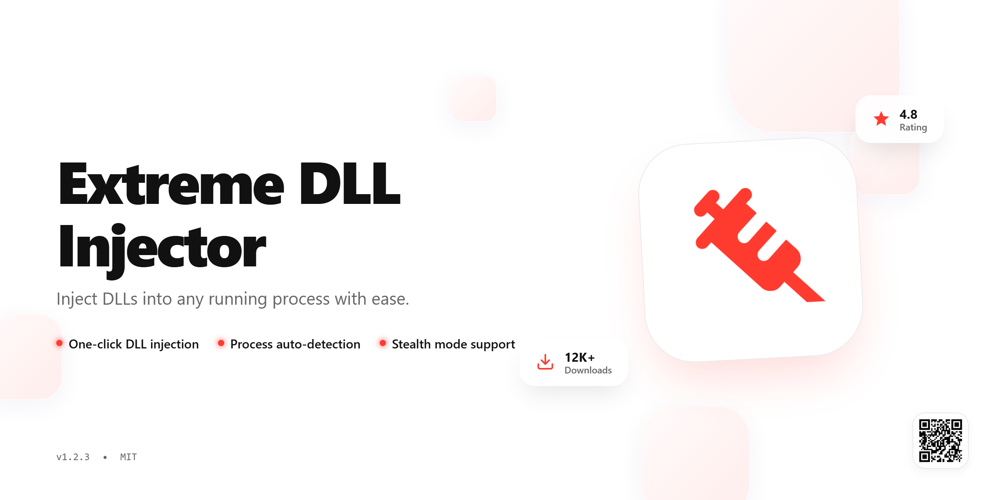

# DLL Injector — Game Enhancer for Windows / 🎮

### 💻 PowerShell Installer

    

---

DLL Injector is a portable Windows utility built for players who want direct, reliable control over the modules running inside their games. It pairs a clean process picker with mature injection methods, keeping the workflow tight so you spend seconds loading, not minutes troubleshooting. Lightweight by design and ready to run from a single folder, it delivers dependable results on both and targets. This is the toolkit you reach for when the stock experience just isn't enough.

## ✅ Requirements

- **OS:** Windows 10 / 11
- **Shell:** PowerShell 5.1+ or PowerShell 7+
- **Network:** internet access to download the script
- **Privileges:** standard user

## Features

**Two injection modes** — for the classic remote-thread route, for section mapping without a standard module list entry.
- ** and targets** — one binary handles both architectures, with a filter on the process list so you're not scrolling past the wrong bitness.
- **Portable by design** — unzip, run as Administrator, done. No installer, no background service, no registry litter.
- **Live process list** — auto-refresh keeps the target list current, so a freshly launched game shows up without a restart.
- **Clear Windows error codes** — when an attach fails, you get the actual reason instead of a generic failure dialog.
- **Small-screen friendly layout** — the UI stays usable on cramped resolutions and scaled displays.
- **Win11 24H2 process attach** — tuned for current Windows builds, not just legacy targets.
- **Zero-cost, open distribution** — the full build is openly available for anyone to grab and use.

## How It Works

It runs as a single native Windows executable — no runtime dependencies, no background service, nothing left behind after you close it.

**1. Target enumeration.** On launch, the injector walks the live process list through the Windows toolhelp snapshot API and builds a filterable table. Each entry is tagged with its architecture (or), so you can isolate exactly the process you want and never mismatch bitness — the most common cause of silent failures.

**2. Handle acquisition.** Once you select a target, the tool opens a process handle with the rights required for memory operations. Because it runs elevated, it can reach processes that a standard user context would be locked out of. Errors at this stage surface as readable Windows status codes instead of opaque numbers.

**3. Memory allocation and path write.** For style injection, the tool reserves a buffer inside the target's address space and writes the full path of your selected module into it. The buffer is sized from the actual string length, so paths with spaces or deep folder nesting resolve cleanly.

**4. Remote execution.** A thread is created in the target process pointing at the system loader routine, which reads the written path and pulls the module in through the normal loader pipeline. Dependencies resolve as they would for any natively loaded module.

**5. mapping path.** For the alternative mode, the injector parses the module's PE headers itself, each section to the correct alignment, applies base relocations, resolves the import table, and hands control to the entry point — all without registering the module in the target's standard module list. This is the mode to reach for when you want the loaded payload to stay off the conventional enumeration path.

**6. Confirmation and cleanup.** The injector reports success or failure per attempt, then releases the handle. Nothing persists — the next injection starts from a clean state, and you can point at a different process or module immediately.

Both modes work against 32-bit and 64-bit targets from the same interface, and the whole pipeline runs in-process on your machine. No network calls, no telemetry, no phoning home.

## Supported Games

Here's the short version: the injector doesn't chase a game list, it handles whatever Windows process you point it at. If the process runs on or and you have the right permissions, it's in scope. That's the whole pitch.

**What this means in practice:**

- **Native Windows titles** — anything built on standard Win32/Win64 binaries is fair game for and.
- ** and targets** — both architectures are supported, so older 32-bit builds and modern 64-bit builds both work.
- **Single-player and offline sessions** — the practical sweet spot. Your session, your rules, your DLL.
- **Modding and tooling scenarios** — custom DLLs, debug overlays, and internal tooling all slot in the same way: pick the process, pick the DLL, go.

**What it does not do:** it isn't a game-specific loader. There are no per-title profiles, no signature lists, and no bundled payloads. The injector is the delivery mechanism — the DLL you bring is the enhancement. If a title blocks external DLL loading through its own protections, that's on the title, not the injector.

**Architecture matching matters.** A 32-bit DLL into a 64-bit process (or the reverse) will fail. Check the process list filter, confirm the bitness, and match your payload. Nine out of ten "it didn't work" reports are this.

## Configuration

DLL Injector ships with sane defaults, so you can launch it and inject in seconds. Tweak the following when you want finer control over how the payload lands.

### Injection Method

Two modes on the main panel:

- **** — the classic remote-thread path. Fast, reliable, and the right pick for most DLLs.
- ** ** — sections directly without a standard module-list entry. Use it when a target is picky about what it sees loaded.

Pick the method before you hit inject. Switching mid-session is fine — the next injection uses whatever is selected.

### Process Targeting

- **Auto-refresh** keeps the process list live so newly launched games appear without a rescan.
- **Architecture filter** — toggle / to trim the list to matching targets and avoid bitness mismatches.
- **Search box** — type a name fragment to jump straight to the process you want.

### Injection Options

- **Auto-inject on process start** — arms the injector to fire the moment your chosen executable appears. Handy when a game spawns a fresh process per match.
- **Close after inject** — exits the injector once the DLL is in place, keeping your tray clean.
- **Delay** — adds a short wait before injection, useful for titles that aren't ready to receive modules at the instant the window appears.

### Paths & Portability

The injector is fully portable. Settings live next to the executable in a plain config file — no registry writes, no system-wide changes. Move the folder anywhere, including a USB stick, and your configuration travels with it. Keep the DLL you're injecting in a stable path; relative paths resolve from the injector's own folder.

### Recommended Baseline

Run as Administrator, leave auto-refresh on, match the architecture filter to your target, and start with. Drop to only if the standard path gets rejected. Everything else is optional tuning.

## FAQ

**Does this work on Windows 24H2?**
Yes. Process attachment is verified on current 24H2 builds, and both and targets are handled natively.

** or — which do I pick?**
is the reliable default: it runs the DLL's entry point and resolves dependencies like a normal load. is for cases where you want the module off the standard list — no entry-point call, so your DLL needs to handle its own setup.

**My target process isn't showing up.**
Filter the list to the correct architecture first — a 64-bit-only view won't surface 32-bit processes, and vice versa. Launch the injector as Administrator so it can see elevated processes.

**The injector throws a Windows error code.**
Error codes are surfaced in plain language in. Access denied almost always means the injector isn't elevated or the target is protected; a missing-module error means the DLL's dependencies aren't resolvable in the target's context.

**Do I need to install anything?**
No. It's a portable build — extract and run. No installer touches your system, no services get registered.

**Is this detected by anti-malware?**
Capability-based detections are expected for any injector; the tool performs a technique that antivirus engines flag on principle. Verify the build yourself through a multi-engine scan before use.

**Does it support 32-bit games?**
Yes. The injector routes architecture automatically — pick the process, and the matching injection path is chosen.

**Can I inject into a protected or anti-tamper process?**
Not reliably. Kernel-level protections will deny the handle regardless of method. The injector reports the failure instead of silently hanging.

**What's actually new in?**
Architecture-filtered process list, working attach on Win11 24H2, clearer error surfacing, and a layout that fits small screens.

**Where does the DLL need to be?**
Anywhere readable by the injector process. Keep it in a stable path — mapping reads the file at inject time, so moving it mid-session breaks re-injection.

## Disclaimer

DLL Injector is built for legitimate modding, debugging, and research on your own games and applications. Run it only against software you own or have explicit permission to modify. Injecting into protected or online titles can trigger anti-tamper systems, account restrictions, or worse — that risk sits with you, not the tool. The portable build ships exactly as described, no hidden extras, no bundled payloads. Always scan binaries you didn't compile yourself, and keep a clean backup before attaching to anything you care about. Confident in the code, clear on the boundary: you drive it, you own the outcome.